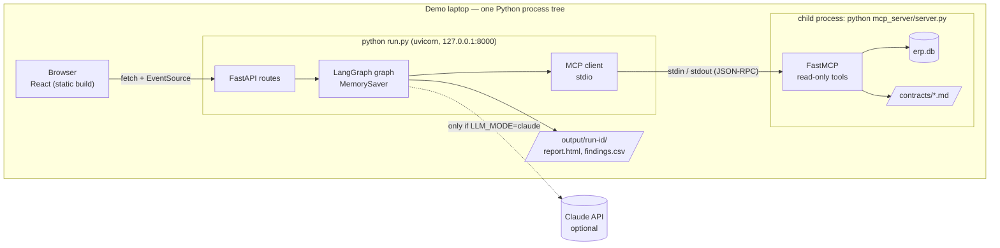
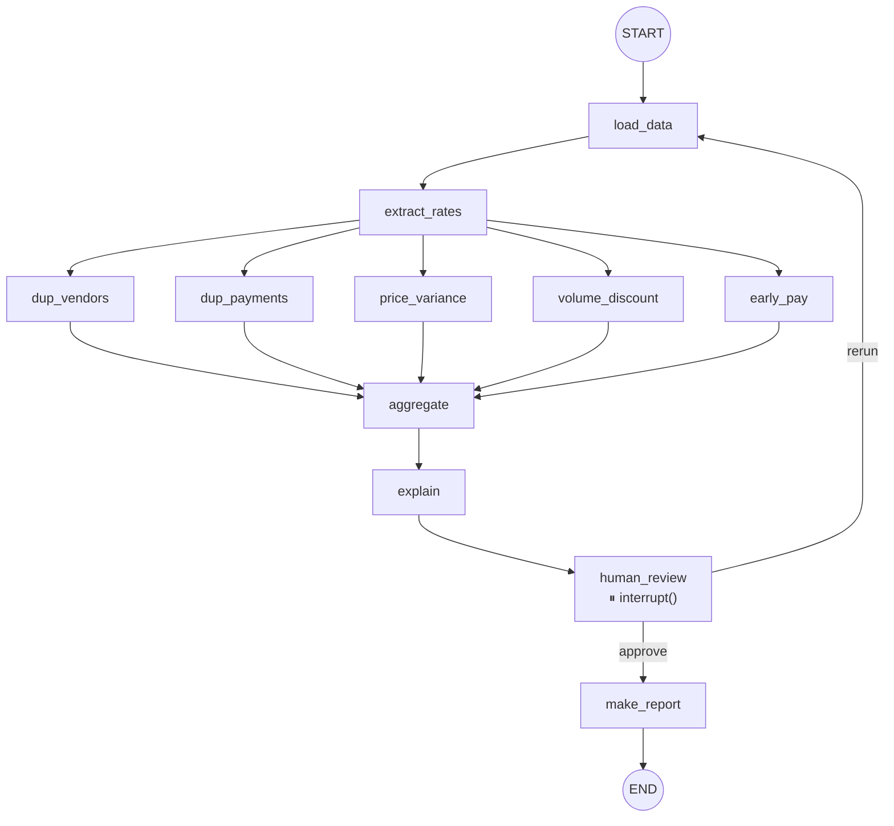

# Low-Level Design: Spend & Contract Leakage Analyzer (Lite)

| | |
|---|---|
| **Document** | Low-Level Design (LLD) |
| **Version** | 0.2: simplified for a restricted IT environment |
| **Date** | 2026-11-17 |
| **Stack** | React · FastAPI · LangGraph · local MCP server · SQLite (file) · Claude API (optional) |
| **Constraint** | No Docker, no database server, no message queue, no extra infrastructure. Python + Node only. |

---

## 0. What changed from v0.1

| Area | v0.1 | v0.2 (this version) | Why |
|---|---|---|---|
| Packaging | Docker Compose, 3 containers | **None.** A Python venv and a static React build | Docker isn't allowed |
| Processes to start | 3 (frontend, backend, MCP server) | **1** (`python run.py`) | The backend starts the MCP server itself and also serves the built React files |
| MCP transport | Streamable HTTP on port 8765 | **stdio** (child process, no network port) | No port to open, no firewall prompt, nothing to approve with IT |
| Databases | `erp.db` + `app.db` + `checkpoints.db` | **`erp.db` only** (Python's built-in `sqlite3`) | Run state lives in memory; a demo doesn't need restart recovery |
| LangGraph checkpointer | `AsyncSqliteSaver` (extra package) | **`MemorySaver`** (built into LangGraph) | One fewer package |
| Fuzzy matching | `rapidfuzz` | **`difflib`** (standard library) | One fewer package |
| Contracts | PDF + Markdown, `pypdf` | **Markdown files only** | One fewer package |
| Reports | WeasyPrint PDF + openpyxl Excel | **HTML report** (browser "Print → Save as PDF") + **CSV** (opens in Excel) | WeasyPrint needs native GTK libraries on Windows, which is a common blocker |
| Frontend libraries | Tailwind, shadcn, TanStack Query, React Flow, Recharts, TypeScript | **React + Vite only**, plain CSS, `fetch`, `EventSource` | Smallest possible npm footprint |
| Detectors | 7 | **5** | Dropped the two estimate-based ones (off-contract spend, expired contract). Same tech, less code |
| Observability | structlog, LangSmith | Python `logging` | LangSmith sends data off the machine |
| Tests | pytest, hypothesis, Playwright | **pytest** only | |
| LLM | Required | **Optional** (`LLM_MODE=off` runs fully offline) | The demo still works if outbound API calls are blocked |

---

## 1. Purpose and scope

The agent reads a client's accounts-payable data **through a local MCP server**, finds money being lost, pauses for a consultant to review, then produces a report.

**Detectors in v0.2**
1. Duplicate vendors
2. Duplicate payments
3. Price above contract rate
4. Missed volume discount
5. Missed early-payment discount

**Design rule:** all dollar amounts are calculated by plain Python. The LLM only:
- pulls price tables out of contract text,
- decides borderline vendor-name matches,
- writes a short explanation for each finding.

**Demo goals**
- One command to start.
- Under 2 minutes from "Analyze" to the review screen.
- Every planted anomaly is found, every time.

---

## 2. Approved technology list

This is the complete list to send to IT for approval.

### 2.1 Runtime (demo machine)

| Item | Purpose | Notes |
|---|---|---|
| **Python 3.11+** | Backend, MCP server, data generator | |
| `fastapi` | REST API + live event stream | |
| `uvicorn` | Runs FastAPI | |
| `langgraph` | Agent workflow, human-review pause, in-memory checkpointer | |
| `mcp` | Official MCP Python SDK: the server (`FastMCP`) and the client (`ClientSession` over stdio) | |
| `anthropic` | Claude API client | Optional. Only needed when `LLM_MODE=claude` |
| **Python standard library** | `sqlite3`, `csv`, `difflib`, `decimal`, `asyncio`, `json`, `re`, `logging`, `html` | No install needed |

Pin exact versions with `pip freeze > requirements.lock` on the first install and send that file to IT. It includes the packages these pull in (for example `pydantic`, `httpx`, `starlette`, `anyio`).

### 2.2 Build time only (developer machine)

| Item | Purpose |
|---|---|
| **Node.js LTS** | Build the React app |
| `react`, `react-dom` | UI |
| `vite`, `@vitejs/plugin-react` | Dev server and build |

`npm run build` writes static files to `frontend/dist/`, which FastAPI serves. **The demo machine doesn't need Node at all.** Copy the `dist` folder over.

### 2.3 Network

| Mode | Outbound traffic |
|---|---|
| `LLM_MODE=off` | **None.** Fully offline |
| `LLM_MODE=claude` | HTTPS to `api.anthropic.com` only. Behind a corporate proxy, set `HTTPS_PROXY` |

There are **no listening ports except `127.0.0.1:8000`**, which serves the UI and API. The MCP server has no port at all; it talks to the backend over stdin/stdout.

---

## 3. Architecture



**Startup sequence**
1. `run.py` calls `uvicorn.run(app, host="127.0.0.1", port=8000)`.
2. On startup, FastAPI's `lifespan` handler launches `mcp_server/server.py` as a **child process** using the MCP SDK's `stdio_client`. It opens one `ClientSession`, which all runs share.
3. FastAPI mounts `frontend/dist/` at `/`, so `http://127.0.0.1:8000` opens the app.
4. On shutdown, the session closes and the child process exits.

**Data-locality statement for the demo**
- Raw data (the database and contract files) is read **only** by the MCP child process, on this laptop.
- With `LLM_MODE=off`, nothing leaves the machine.
- With `LLM_MODE=claude`, the model sees only small excerpts: one contract's text at a time, vendor-name pairs, and per-finding evidence summaries. Don't say "nothing leaves the network" in this mode.

---

## 4. Project layout

```
spend-leakage/
├── run.py                     # single entry point
├── requirements.txt
├── .env.example
├── seed/
│   └── generate.py            # builds data/erp.db + data/contracts/*.md + planted_anomalies.json
├── data/                      # generated, git-ignored
├── output/                    # reports, git-ignored
├── mcp_server/
│   └── server.py              # FastMCP app, ~150 lines
├── backend/
│   ├── app.py                 # FastAPI app, lifespan, routes, static mount
│   ├── config.py              # reads .env via os.environ
│   ├── mcp_client.py          # open session, call_tool wrapper + audit log
│   ├── llm.py                 # Claude calls, or a no-op when LLM_MODE=off
│   ├── runs.py                # RunManager: background tasks + event lists
│   ├── models.py              # Pydantic models
│   ├── graph/
│   │   ├── state.py
│   │   ├── build.py
│   │   ├── nodes.py           # load_data, extract_rates, aggregate, explain, review, report
│   │   └── detectors.py       # 5 pure functions
│   └── report/
│       ├── report.html        # string.Template, no Jinja
│       └── render.py
├── tests/
│   ├── test_detectors.py
│   └── test_end_to_end.py
└── frontend/
    ├── package.json
    ├── vite.config.js         # dev proxy /api -> 127.0.0.1:8000
    └── src/
        ├── main.jsx
        ├── App.jsx            # tiny router: state-based, no react-router
        ├── api.js             # fetch helpers + useRunEvents hook
        ├── pages/
        │   ├── StartPage.jsx
        │   ├── RunPage.jsx
        │   ├── ReviewPage.jsx
        │   └── ResultsPage.jsx
        └── styles.css
```

---

## 5. Data

### 5.1 `erp.db` (read only by the MCP server)

```sql
CREATE TABLE vendors (
    vendor_id    TEXT PRIMARY KEY,
    name         TEXT NOT NULL,
    tax_id       TEXT,
    address      TEXT,
    category     TEXT
);

CREATE TABLE contracts (
    contract_id   TEXT PRIMARY KEY,
    vendor_id     TEXT NOT NULL,
    start_date    TEXT NOT NULL,      -- ISO date
    end_date      TEXT NOT NULL,
    payment_terms TEXT,               -- e.g. '2/10 NET 30'
    document_file TEXT NOT NULL       -- e.g. 'C0042.md'
);

-- Structured price table. Left EMPTY for ~10 contracts on purpose,
-- so the LLM has something to extract from the contract text.
CREATE TABLE contract_rates (
    contract_id TEXT,
    sku         TEXT,
    unit_price  REAL,
    min_qty     INTEGER DEFAULT 0,    -- volume tier start (per year)
    PRIMARY KEY (contract_id, sku, min_qty)
);

CREATE TABLE invoices (
    invoice_id        TEXT PRIMARY KEY,
    vendor_id         TEXT NOT NULL,
    vendor_invoice_no TEXT NOT NULL,
    invoice_date      TEXT NOT NULL,
    total_amount      REAL NOT NULL
);

CREATE TABLE invoice_lines (
    line_id     TEXT PRIMARY KEY,
    invoice_id  TEXT NOT NULL,
    sku         TEXT,
    quantity    REAL NOT NULL,
    unit_price  REAL NOT NULL
);

CREATE TABLE payments (
    payment_id  TEXT PRIMARY KEY,
    invoice_id  TEXT NOT NULL,
    paid_date   TEXT NOT NULL,
    amount      REAL NOT NULL
);
```

SQLite stores money as `REAL`. The detectors convert to `Decimal` before doing any arithmetic.

### 5.2 Synthetic data (`seed/generate.py`, fixed random seed)

About 120 vendors, 30 contracts (Markdown), 1,500 invoices, 4,000 lines and 1,500 payments over 24 months.

| Planted anomaly | Count | Roughly adds up to |
|---|---|---|
| Duplicate vendor pairs (same tax ID or near-identical name) | 6 | Counted for risk, $ estimated |
| Duplicate payments | 8 | ~$95K |
| Prices above contract rate | 25 lines | ~$130K |
| Missed volume discount | 3 vendors | ~$85K |
| Missed early-payment discount | 30 invoices | ~$40K |

The ground truth is written to `data/planted_anomalies.json` and used by the tests. Each entry has a `needs_llm` flag:
- `false` (most entries): the anomaly is on a contract that has a price table in the database, or it's a vendor pair caught by tax ID or a name ratio ≥ 0.90. These are always found, even with `LLM_MODE=off`.
- `true` (a few entries): the anomaly is on a contract whose prices exist only in the Markdown text, or it's a borderline vendor-name pair. These are found only with `LLM_MODE=claude`. This is the visible "value of the LLM" moment in the demo.

### 5.3 Run state (in memory, owned by the backend)

There is no application database:
- LangGraph's `MemorySaver` holds the graph state.
- `RunManager` keeps a `dict[run_id → RunRecord]` with status, the event list and the findings.
- Reports are files under `output/<run_id>/`.

Restarting the server clears run history, which is acceptable for a demo.

---

## 6. Local MCP server (`mcp_server/server.py`)

**Implementation**
- `FastMCP("erp-data")` with `mcp.run()`, which defaults to stdio.
- SQLite is opened with `sqlite3.connect("file:data/erp.db?mode=ro", uri=True)`, so writes are impossible.
- No tool accepts free-form SQL.
- `read_contract` only opens files inside `data/contracts/`, after checking the resolved path.

| Tool | Arguments | Returns |
|---|---|---|
| `get_summary` | — | Row counts per table (shown on the start page) |
| `list_vendors` | — | All vendors |
| `list_contracts` | — | Contract metadata |
| `get_contract_rates` | `contract_id` | Rate tiers (may be empty) |
| `read_contract` | `contract_id` | Contract Markdown text |
| `get_invoices` | `date_from`, `date_to` | Invoices with their lines |
| `get_payments` | `date_from`, `date_to` | Payments |

At demo scale, a single call returns everything (a few MB). No paging is needed.

```python
mcp = FastMCP("erp-data")
db = sqlite3.connect(f"file:{DB_PATH}?mode=ro", uri=True, check_same_thread=False)
db.row_factory = sqlite3.Row

@mcp.tool()
def get_invoices(date_from: str, date_to: str) -> list[dict]:
    """Invoices dated between date_from and date_to (ISO dates), each with its lines. Read-only."""
    invs = [dict(r) for r in db.execute(
        "SELECT * FROM invoices WHERE invoice_date BETWEEN ? AND ?", (date_from, date_to))]
    lines = defaultdict(list)
    for r in db.execute("SELECT * FROM invoice_lines"):
        lines[r["invoice_id"]].append(dict(r))
    for inv in invs:
        inv["lines"] = lines[inv["invoice_id"]]
    return invs

if __name__ == "__main__":
    mcp.run()          # stdio
```

**Audit log.** `backend/mcp_client.py` wraps every `session.call_tool()` call. For each call it records the tool name, arguments, row count, bytes and duration, and emits a `tool_call` event. This powers the "Data stays local" panel. The panel shows the transport as `stdio · local process (pid 12345)`.

---

## 7. LangGraph workflow

### 7.1 Graph



The five detectors are wired with plain parallel edges, so no `Send` API is needed. LangGraph runs them in the same step and waits for all of them before `aggregate`.

### 7.2 State

```python
class RunState(TypedDict, total=False):
    run_id: str
    params: dict                       # date_from, date_to, price_tolerance_pct, ...
    vendors: list[dict]
    contracts: list[dict]
    invoices: list[dict]
    payments: list[dict]
    rate_cards: dict[str, list[dict]]  # contract_id -> tiers
    # Each detector writes ONLY its own key, so a rerun simply overwrites it.
    detector_results: Annotated[dict[str, list[dict]], lambda a, b: {**(a or {}), **b}]
    findings: list[dict]               # ranked, set by aggregate
    decisions: dict | None
    iteration: int
```

Detectors return `{"detector_results": {"price_variance": [...]}}`. Because every detector writes its own key, parallel writes don't collide, and a rerun replaces the old results instead of adding to them.

### 7.3 Nodes

| Node | What it does |
|---|---|
| `load_data` | Calls `list_vendors`, `list_contracts`, `get_invoices` and `get_payments` over MCP (`asyncio.gather`). Increments `iteration`; stops with an error if it goes above 3. |
| `extract_rates` | For each contract, calls `get_contract_rates`. If the result is empty and `LLM_MODE=claude`, calls `read_contract` and asks the LLM for the price table as structured JSON. It validates the result: price > 0, and the SKUs must appear on that vendor's invoices. With `LLM_MODE=off`, those contracts are skipped and listed in a warning. |
| 5 × detectors | Pure Python functions (§7.4). `dup_vendors` may send borderline pairs to the LLM. |
| `aggregate` | Removes overlaps: an invoice line counts once, with priority duplicate payment > price variance > volume discount. Computes `score = amount × confidence`, assigns severity (HIGH ≥ $25K, MEDIUM ≥ $5K), sorts and assigns IDs `F-001…`. |
| `explain` | `LLM_MODE=claude`: one call per 10 findings, returning a short explanation each. `LLM_MODE=off` or on error: a fixed sentence template per finding type. |
| `human_review` | `decision = interrupt({"findings": ..., "summary": ...})`. Applies approve/reject/adjust, then routes to `rerun` (with new parameters) or `approve`. |
| `make_report` | Writes `output/<run_id>/report.html` (string template with simple CSS bars) and `findings.csv` (standard `csv` module). Only approved and adjusted findings are included. |

### 7.4 Detectors (`detectors.py`)

Each detector is a function `(state) -> list[Finding]`, with no I/O, so it's easy to unit-test.

| Detector | Rule | Amount at risk | Confidence |
|---|---|---|---|
| **Duplicate vendors** | Normalize names (lowercase, strip punctuation and Inc/LLC/Ltd/Pvt/Corp). Same `tax_id` → match. Otherwise `difflib.SequenceMatcher(...).ratio() ≥ 0.90` → match. A ratio of 0.80–0.90 goes to the LLM, or is skipped when the LLM is off. | Smaller vendor's spend × 3% (lost negotiating leverage, stated in the evidence) | 0.95 for tax ID, 0.8 for name match |
| **Duplicate payments** | Same vendor (duplicate-vendor pairs merged) and same amount, and either the normalized invoice number matches (uppercase, letters/digits only, no leading zeros) or the dates are within 14 days. Both must be paid. | The later payment | 0.95 if the invoice number matches, else 0.75 |
| **Price above contract** | For each invoice line, find the active contract and the tier for the year-to-date quantity. Flag if the billed price > contract price × (1 + tolerance, default 2%). Group by vendor + SKU. | Σ (billed − contract) × qty | 0.9 from the DB table, 0.75 if the price was LLM-extracted |
| **Missed volume discount** | Running yearly quantity per contract + SKU. Lines after the next tier's `min_qty` is crossed, still billed at the lower tier's price. | Σ (billed − tier price) × qty | 0.85 |
| **Missed early-pay discount** | Parse terms with `r"(\d+(?:\.\d+)?)/(\d+)\s*NET\s*(\d+)"`. Flag if paid after the discount window. | Invoice total × discount % | 0.9 |

Every finding carries an `evidence` object containing the referenced invoice, line and payment IDs, a contract clause excerpt where relevant, and a **calculation string**, for example `(48.50 − 42.00) × 1,200 = $7,800.00`.

### 7.5 Review payloads

Sent to the UI when the graph pauses:
```json
{ "summary": {"total": 351200.00, "count": 64, "by_type": {"PRICE_VARIANCE": 131200.00}},
  "findings": [ {"id": "F-001", "type": "DUPLICATE_PAYMENT", "vendor": "Acme Supply", "amount": 18400.00,
                 "confidence": 0.95, "severity": "HIGH", "calculation": "...", "evidence": {...}, "explanation": "..."} ] }
```

Sent back to resume (`Command(resume=...)`):
```json
{ "action": "approve",
  "decisions": { "F-001": {"status": "APPROVED"},
                 "F-012": {"status": "REJECTED", "note": "Known rebate"},
                 "F-031": {"status": "ADJUSTED", "amount": 4200.00} },
  "new_params": null }
```

Findings with no decision are left out of the report.

---

## 8. Backend (FastAPI)

### 8.1 Endpoints

| Method | Path | Purpose |
|---|---|---|
| `GET` | `/api/health` | `{mcp: "up", llm_mode: "claude" or "off", data: {vendors: 120, ...}}` |
| `POST` | `/api/runs` | Body: params. Starts a run and returns `{run_id}` |
| `GET` | `/api/runs/{id}` | Status, summary, findings |
| `GET` | `/api/runs/{id}/events` | Live event stream (Server-Sent Events) |
| `POST` | `/api/runs/{id}/review` | Body: the resume payload from §7.5. Returns 409 unless status is `AWAITING_REVIEW` |
| `GET` | `/api/runs/{id}/report.html` | The report (open it, then print to PDF) |
| `GET` | `/api/runs/{id}/findings.csv` | CSV download |
| `GET` | `/` | Static React build (`StaticFiles(directory="frontend/dist", html=True)`) |

### 8.2 Running the graph and streaming events

There's no extra library for streaming. It uses FastAPI's own `StreamingResponse`.

```python
class RunManager:
    def __init__(self, graph):
        self.graph, self.runs = graph, {}           # run_id -> RunRecord(status, events, cond)

    async def start(self, run_id, params):
        self.runs[run_id] = RunRecord()
        asyncio.create_task(self._drive(run_id, {"run_id": run_id, "params": params, "iteration": 0}))

    async def resume(self, run_id, payload):
        asyncio.create_task(self._drive(run_id, Command(resume=payload)))

    async def _drive(self, run_id, inp):
        rec, cfg = self.runs[run_id], {"configurable": {"thread_id": run_id}}
        rec.status = "RUNNING"
        try:
            async for mode, chunk in self.graph.astream(inp, cfg, stream_mode=["updates", "custom"]):
                await rec.emit(to_event(mode, chunk))
            snap = await self.graph.aget_state(cfg)
            rec.status = "AWAITING_REVIEW" if snap.next else "COMPLETED"
        except Exception as e:
            rec.status = "FAILED"; await rec.emit({"type": "error", "message": str(e)})
        await rec.emit({"type": "status", "status": rec.status})

@app.get("/api/runs/{run_id}/events")
async def events(run_id: str):
    rec = manager.runs[run_id]
    async def gen():
        i = 0
        while True:
            async with rec.cond:
                await rec.cond.wait_for(lambda: len(rec.events) > i)
            while i < len(rec.events):
                yield f"id: {i}\ndata: {json.dumps(rec.events[i])}\n\n"; i += 1
    return StreamingResponse(gen(), media_type="text/event-stream")
```

Every event is kept in `rec.events`, so a browser refresh replays the whole run from the start.

**Event types:** `node_started`, `node_done`, `tool_call`, `llm_call`, `finding`, `review_required`, `report_ready`, `error`, `status`.

### 8.3 Windows note
Starting the MCP child process needs an asyncio event loop that supports subprocesses. On Windows, start the server with `python run.py`, which calls `uvicorn.run(app)` **without `--reload`**. Uvicorn's reload mode on Windows can switch to an event loop that can't start subprocesses, and the MCP connection will fail at startup. During development, restart manually after backend changes, or run the MCP server over HTTP for that session only.

---

## 9. LLM (`backend/llm.py`)

| Setting | Value |
|---|---|
| `LLM_MODE` | `off` (default for the first run) or `claude` |
| Client | Official `anthropic` Python SDK (`AsyncAnthropic`) |
| Model | `claude-opus-5-5`; override with `LLM_MODEL` |
| Output | Structured JSON validated against a Pydantic model; never free-text parsing |
| Refusals | Server-side `fallbacks: "default"` is enabled. The code always checks `stop_reason` before reading the response |
| On any failure | The node uses its offline fallback (skip the contract, skip the pair, or use a template sentence). A run never fails because of the LLM |

| Use | Effort | Input sent | Output |
|---|---|---|---|
| Extract a price table | `high` | One contract's Markdown + the SKUs seen on its invoices | `[{sku, unit_price, min_qty, clause}]` |
| Borderline vendor match | `low` | Up to 25 name/address pairs | `[{pair_id, same_company, reason}]` |
| Explain findings | `medium` | 10 findings: type, amount, calculation, evidence excerpt | `[{id, explanation}]` (≤ 60 words) |

**Prompt-injection guard.** Contract text is wrapped in `<contract>` tags and treated as data. Extracted prices are checked against invoice SKUs before use, and the LLM never sets any dollar figure.

**Cost.** About $1–3 per run with `claude`, and $0 with `off`.

---

## 10. Frontend (React + Vite, plain JavaScript)

No UI library, router, chart library or state library. There are four pages, switched with a `page` state value in `App.jsx`.

| Page | Shows | Built with |
|---|---|---|
| **Start** | Data summary from `/api/health` (vendors, invoices, contracts, "Source: local MCP, stdio"); date range and price tolerance inputs; **Analyze** button; LLM mode badge | Form + `fetch` |
| **Run (live)** | Step list (load → rates → 5 detectors → aggregate → explain) with ⏳/✅ icons; "Data stays local" log of MCP calls; findings appearing as cards; a running $ total | `EventSource` in a `useRunEvents` hook (`useReducer`) |
| **Review** | Summary tiles; findings table sortable by amount; click a row to see the evidence and calculation; Approve / Reject / Adjust with a note per row; "Approve all HIGH" button; **Submit** or **Re-run with new tolerance** | Plain `<table>`, local state |
| **Results** | Totals by type as CSS bar rows (`<div style={{width: pct + '%'}}>`); top 10 vendors; buttons to **Open report** (new tab, print to PDF) and **Download CSV** | Plain JSX + CSS |

In development, `vite.config.js` proxies `/api` to `http://127.0.0.1:8000`, so the backend needs no CORS setup.

---

## 11. Configuration (`.env`, read with `os.environ`)

```
HOST=127.0.0.1
PORT=8000
ERP_DB_PATH=data/erp.db
CONTRACTS_DIR=data/contracts
OUTPUT_DIR=output
LLM_MODE=off                 # off | claude
LLM_MODEL=claude-opus-5-5
ANTHROPIC_API_KEY=           # only when LLM_MODE=claude
HTTPS_PROXY=                 # if the company requires a proxy
PRICE_TOLERANCE_PCT=2
```

To avoid needing `python-dotenv`, `config.py` reads `.env` with a 10-line parser.

---

## 12. How to run

**First time (developer machine)**
```bash
python -m venv .venv
```
```bash
.venv\Scripts\activate
```
```bash
pip install -r requirements.txt
```
```bash
python seed/generate.py
```
```bash
cd frontend && npm install && npm run build
```

**Every time (demo machine)**
```bash
python run.py
```
Then open `http://127.0.0.1:8000`.

To move it to a demo laptop without Node, copy the project folder including `frontend/dist/` and `data/`, then create the venv and `pip install` on that machine.

---

## 13. Error handling

| Problem | What happens |
|---|---|
| MCP child process fails to start | `/api/health` reports `mcp: "down"` with the error; the Analyze button is disabled |
| An MCP call fails | Retried twice, then the run fails with a clear message. Click Analyze again |
| One detector raises | Its result is an empty list plus a warning event; the other detectors continue |
| LLM blocked, slow or refusing | The fallback described in §9. The run continues |
| Rerun loop | Capped at 3 iterations |
| Browser refreshed | The event stream replays from the start |

---

## 14. Testing (pytest only)

| Test | Checks |
|---|---|
| `test_detectors.py` | Each detector against small hand-written inputs: tier boundary, same-day duplicate, invoice-number normalization, terms parsing |
| `test_end_to_end.py` | Seeds the data, runs the graph with `LLM_MODE=off`, auto-approves at the interrupt, then checks that **every planted anomaly with `needs_llm: false` is found** and that the totals match the ground truth within 1% |
| MCP check | Starts the server over stdio, calls each tool, confirms a write attempt fails (read-only) |

Manual rehearsal: a full click-through before every client demo.

---

## 15. Demo script (5 minutes)

1. **Start page:** "120 vendors, 1,500 invoices, 30 contracts, read through a local MCP server on this laptop."
2. **Analyze:** the steps tick off, the MCP log fills up, findings and the running total appear.
3. **Open one finding:** show the invoice line, the contract clause and the calculation.
4. **Review:** reject one ("known rebate"), adjust one, submit.
5. **Results:** open the report and print it to PDF; download the CSV.
6. **Close:** "Replace this SQLite MCP server with one connected to your ERP, and the same agent runs on your real data."

---

## 16. Build plan

| Step | Scope | Estimate |
|---|---|---|
| 1 | Seed generator + MCP server + MCP check | 1.5 days |
| 2 | Graph with load + 5 detectors + aggregate; end-to-end test passing with `LLM_MODE=off` | 2.5 days |
| 3 | FastAPI: runs, events, review, report + RunManager | 1.5 days |
| 4 | React: 4 pages | 2.5 days |
| 5 | LLM features (rate extraction, vendor match, explanations) | 1.5 days |
| 6 | Report template, polish, rehearsal | 1 day |
| **Total** | | **~10 dev-days**, one developer |

Step 5 comes last on purpose. The demo works fully offline after step 4, so if the company doesn't approve the Claude API, nothing is blocked.

---

## 17. Questions to confirm with IT

1. Can we install **Python 3.11+** and `pip install` from PyPI? If not, is there an internal package mirror?
2. Is **Node.js** allowed on a developer machine? It's only needed to build the UI, not on the demo laptop.
3. Is outbound HTTPS to **`api.anthropic.com`** allowed, and is there a proxy? If not, demo with `LLM_MODE=off`.
4. Is running a local web server on **`127.0.0.1:8000`** allowed? It's loopback only, not reachable from the network.
